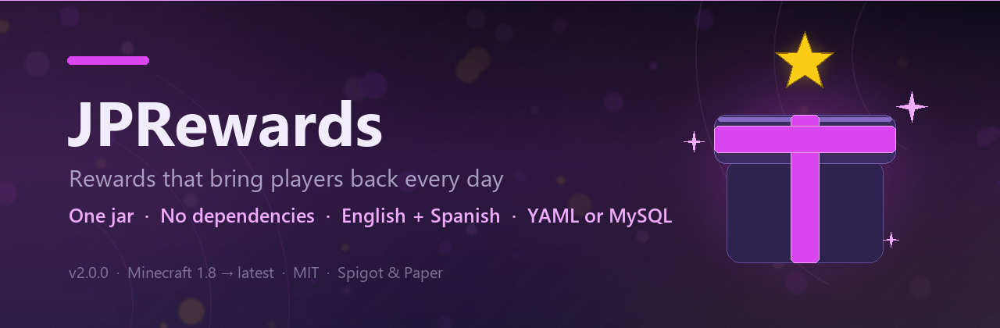
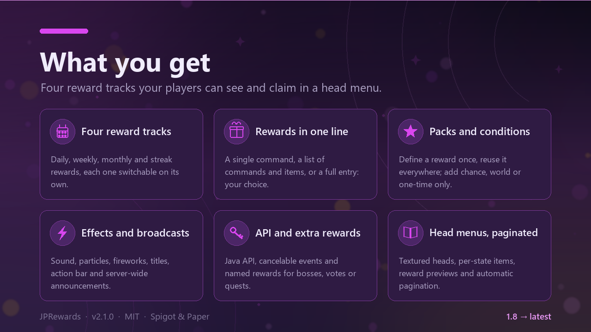
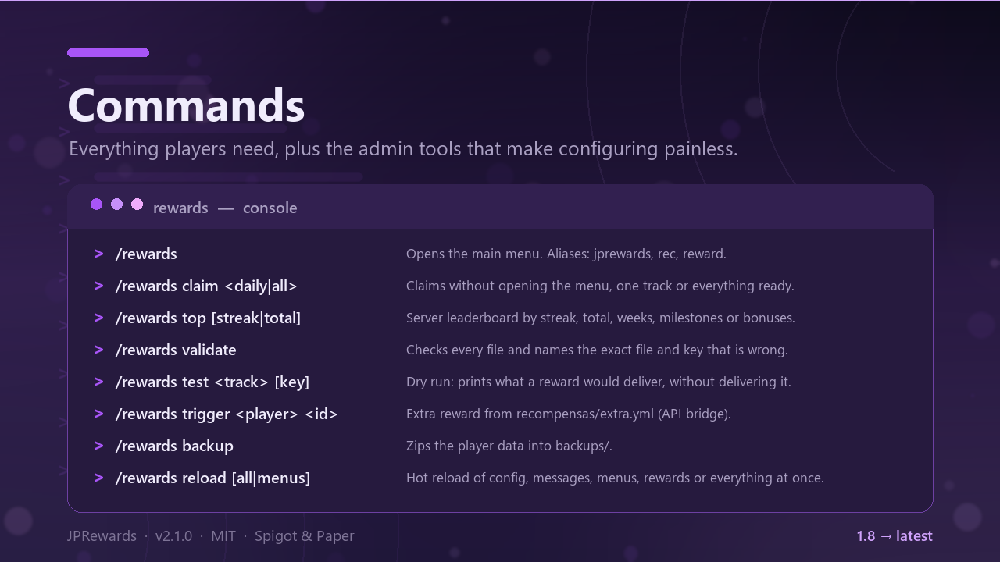
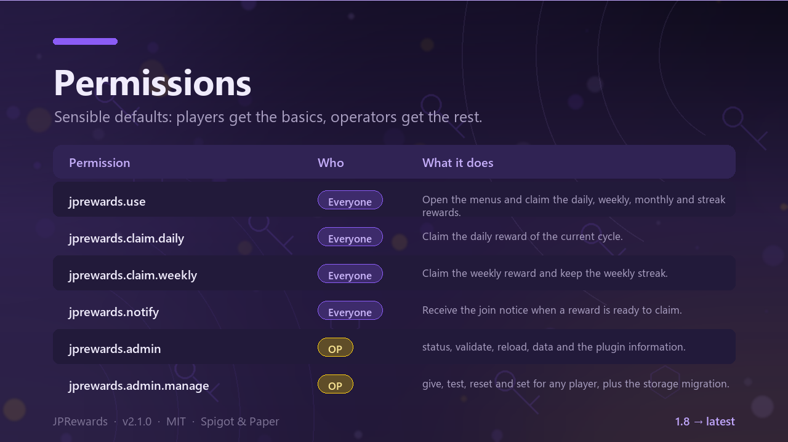
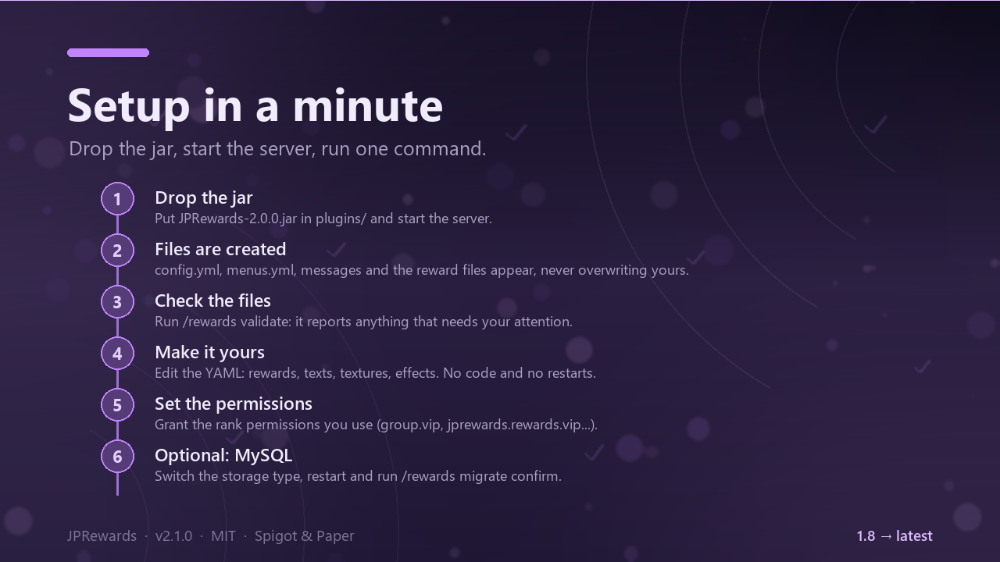
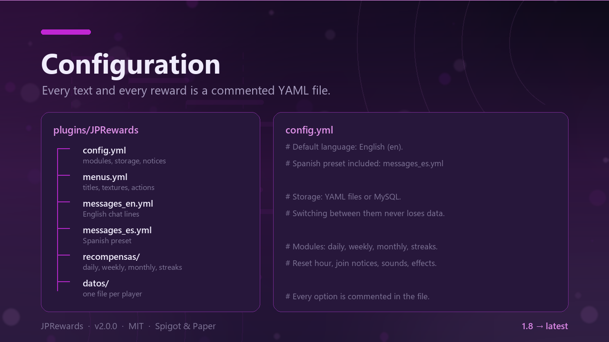
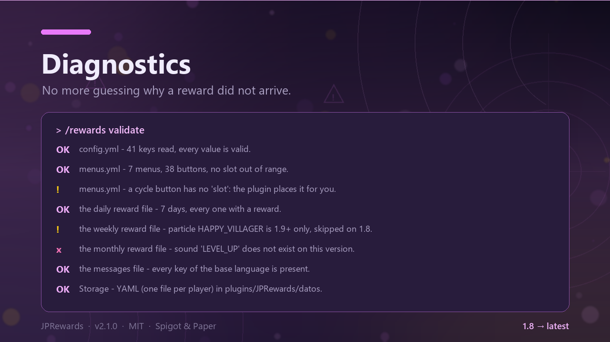
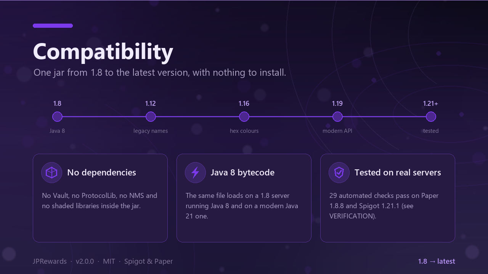

# JPRewards

[](https://www.spigotmc.org/resources/)
[](LICENSE)
[](#requirements)
[](#requirements)
[](docs/VERIFICATION.md)
[](README.es.md)
[](https://github.com/Nameeees/JPRewards/actions/workflows/build.yml)



**Daily, weekly, monthly and streak rewards with fully configurable head menus for Minecraft 1.8 → latest — one jar, no dependencies, no obfuscated code, no NMS dependency.**

> Spanish version of this README: [README.es.md](README.es.md) · All the documentation: [docs/](docs/README.md)

## Table of contents

- [What it does](#what-it-does)
- [Documentation](#documentation)
- [Requirements](#requirements)
- [Installation](#installation)
- [Commands](#commands)
- [Permissions](#permissions)
- [Configuration files](#configuration-files)
- [config.yml reference](#configyml-reference)
- [Quick recipes](#quick-recipes)
- [Reward entries](#reward-entries)
- [Menus](#menus)
- [Placeholders](#placeholders)
- [Storage and migration](#storage-and-migration)
- [How the files are updated on upgrade](#how-the-files-are-updated-on-upgrade)
- [Diagnostics: validate, status and test](#diagnostics-validate-status-and-test)
- [Compatibility and known limits](#compatibility-and-known-limits)
- [Building from source](#building-from-source)
- [Project layout](#project-layout)
- [License](#license)

## What it does

- **Four reward systems**, each one can be switched off on its own:
  - **Daily** — a cycle of N days (`recompensas/diarias.yml`) with a day streak that can be lost when a day is missed.
  - **Weekly** — a cycle of N weeks with a configurable first day of the week and its own weekly streak.
  - **Monthly** — milestones unlocked by claiming the daily reward on enough days of the month; they reset by themselves when the month changes.
  - **Streaks** — bonuses for reaching N days (or weeks) in a row, claimable once per streak.
- **Flexible delivery**: console commands, **direct items** (material, amount, name, lore, enchantments, item flags, custom model data, textured heads) and **experience**.
- **Head menus** with custom textures, per-player states (available / claimed / locked / completed), reward previews, automatic pagination and configurable navigation.
- **Rank variants**: the same entry can give and show something different depending on the permission the player has.
- **Everything is YAML.** Configuration files carry bilingual (Spanish + English) comments, and the menu/reward files ship in English together with ready-to-use Spanish presets (`menus_es.yml`, `recompensas/*_es.yml`).
- **Self-updating configuration files**: on upgrade, new options are appended to the right section with their comments, and nothing you configured is overwritten.
- **`/rewards validate`**: checks every file and tells you exactly what is wrong and where.
- **YAML or MySQL (JDBC) storage**, with `/rewards migrate confirm` to copy the data between them.
- **Conditions on any entry**: `probabilidad` (chance), `mundo` (only in that world) and `una-vez`
  (only the first time for that player).
- **Public API and events** for other plugins (`JPRewardsAPI`, `RewardClaimEvent` — cancelable — and
  `RewardDeliveredEvent`), plus **named extra rewards** in `recompensas/extra.yml` that any plugin or
  command block can grant with `/rewards trigger <player> <id>`. See [docs/API.md](docs/API.md).
- **Delivery history** in `historial.log` (the last five deliveries show up in `/rewards data`) and
  **`/rewards backup`** to zip the player data.
- **MySQL cache invalidation**: with several servers sharing the database, the cache checks the
  `actualizado` column and reloads the data if another server changed it.
- **Optional PlaceholderAPI hook** and **optional new-version notice**.
- **Two bundled languages** (`es`, `en`) plus any language you add yourself.
- Runs on **Spigot, Paper, Purpur** and forks, on old (Java 8) and modern servers with the same jar.

## Documentation

| Page | What it covers |
| --- | --- |
| [docs/](docs/README.md) | Index of every guide and reference. |
| [Commands and permissions](docs/COMMANDS.md) | Every subcommand, alias, argument, permission and example. |
| [Placeholders](docs/PLACEHOLDERS.md) | Menu, message and reward placeholders, plus the PlaceholderAPI expansion. |
| [API for plugins](docs/API.md) | Java API, events and named extra rewards (bosses, votes, quests). |
| [FAQ](docs/FAQ.md) | Languages, MySQL, upgrading from 1.x, duplicate claims, full inventories. |
| [Configuration guide](docs/CONFIGURACION.es.md) | Step-by-step guide to the YAML files (Spanish). |
| [Verification log](docs/VERIFICATION.md) | What was tested, on which servers, with the artifact hash. |
| [Contributing](CONTRIBUTING.md) · [Security](SECURITY.md) | How to send a change and how to report a vulnerability. |

## Gallery

Every image below is generated from code — see [docs/assets/README.md](docs/assets/README.md) and
[docs/SPIGOTMC_PAGE.md](docs/SPIGOTMC_PAGE.md) for where each one goes on the resource page.

| | |
| --- | --- |
|  |  |
|  |  |
|  |  |
|  | |

## Requirements

| | |
| --- | --- |
| Server | Spigot / Paper / Purpur 1.8 → latest (any server implementing the Bukkit API) |
| Java | 8 or newer for the plugin. The server itself still needs whatever its Minecraft version requires (1.21+ → Java 21) |
| Dependencies | None. PlaceholderAPI is optional and only used when installed |
| Database | Optional (MySQL/MariaDB over JDBC). The driver is the one shipped with the server |
| Built against | Spigot API 1.8.8, Java 8 bytecode (class file version 52) |

## Installation

1. Copy `JPRewards-2.0.0.jar` into the server's `plugins/` folder.
2. Start the server. It creates `config.yml`, `messages_es.yml`, `messages_en.yml`, `menus.yml` and the `recompensas/` folder. **Existing files are never overwritten.**
3. Run `/rewards validate` to check that everything is fine.
4. Open the menu with `/rewards` and adjust whatever you want.

> Coming from 1.x: your `messages.yml` is renamed to `messages_es.yml` automatically (same content, new format), `idioma: es` is added to your `config.yml` so the chat stays in Spanish (English is the default only for fresh installs) and **nothing is lost** — not the messages, not the player data. New options are appended to your files with a `.bak` backup first.

Plugins are reloaded, not restarted, at your own risk: the plugin supports `/rewards reload`, which is what you want after editing a file.

## Commands

Main command: `/rewards`. Aliases: `rewards`, `jprewards`, `rec`, `recompensa`.

### Players

| Command | What it does | Permission |
| --- | --- | --- |
| `/rewards` | Opens the main menu. | `jprewards.use` |
| `/rewards daily` | Opens the daily cycle. | `jprewards.use` |
| `/rewards weekly` | Opens the weekly cycle. | `jprewards.use` |
| `/rewards monthly` | Opens the monthly milestones. | `jprewards.use` |
| `/rewards streaks` | Opens the streak bonuses. | `jprewards.use` |
| `/rewards info` | Your streak, totals and next resets. | `jprewards.use` |
| `/rewards claim <diaria\|semanal\|mensual\|rachas\|todo>` | Claims without opening a menu (each type also checks its own `jprewards.claim.*` permission). | `jprewards.use` |
| `/rewards top [racha\|total\|semanas\|hitos\|bonus]` | Server leaderboard (cached for one minute, calculated off the main thread). | `jprewards.top` |
| `/rewards help` | Chat help (`help` and `?` work too). | none |

**The canonical subcommands are Spanish** (the plugin was born in Spanish): `reload`, `test`, `reset`, `set`, `top`, `status`, `validate`, `data`, `give`, `migrate`. The English spellings keep working as silent aliases: `reload`, `test`, `reset`, `set`, `top`, `status`, `validate`, `check`, `data`, `give`, `migrate`, plus `daily`, `weekly`, `monthly`, `streak` and `claim`, `reload`, `data`, `give`, `simulate`, `reset`, `set`, `migrate`.

### Administration

| Command | What it does | Permission |
| --- | --- | --- |
| `/rewards status` | Plugin, storage and configuration status. | `jprewards.admin` |
| `/rewards validate` | Checks **every** file and explains each problem with its exact path. | `jprewards.admin` |
| `/rewards reload [config\|mensajes\|menus\|recompensas\|todo]` | Hot reload of one part or everything (open menus are closed). | `jprewards.admin` |
| `/rewards data <jugador>` | Full report for one player (online or known offline player). | `jprewards.admin` |
| `/rewards give <jugador> <tipo> [clave]` | Delivers a reward for testing, without touching counters or waiting times. **Must be run in game** and the target must be online. | `jprewards.admin.manage` |
| `/rewards test <tipo> [clave]` | **Dry run**: prints exactly what would be delivered (commands, items, XP, effects) and delivers nothing. | `jprewards.admin.manage` |
| `/rewards reset <jugador\|*> [diaria\|semanal\|mensual\|rachas\|todo]` | Resets one player or everyone. | `jprewards.admin.manage` |
| `/rewards set <jugador> <campo> <valor>` | Sets a counter: `racha`, `mejor-racha`, `total`, `racha-semanal`, `total-semanal`, `dias-mes`, `hitos`. | `jprewards.admin.manage` |
| `/rewards migrate confirmar` | Copies **all** data to the other storage backend (see [Storage and migration](#storage-and-migration)). | `jprewards.admin.migrate` |

## Permissions

| Permission | Description | Default |
| --- | --- | --- |
| `jprewards.use` | Open the menus and use `/rewards`. | `true` |
| `jprewards.claim.daily` | Claim the daily reward. | `true` |
| `jprewards.claim.weekly` | Claim the weekly reward. | `true` |
| `jprewards.claim.monthly` | Claim the monthly milestones. | `true` |
| `jprewards.claim.streak` | Claim the streak bonuses. | `true` |
| `jprewards.notify` | Receive the join notice when something can be claimed. | `true` |
| `jprewards.autoclaim` | Claim the daily reward automatically on join (only when `avisos.auto-reclamar.activado` is on). | `false` |
| `jprewards.top` | View the leaderboard with `/rewards top`. | `true` |
| `jprewards.update` | Receive the new-version notice in chat. | OP |
| `jprewards.admin` | `status`, `validate`, `reload` and `data`. | OP |
| `jprewards.admin.manage` | `give`, `test`, `reset` and `set`. | OP |
| `jprewards.admin.migrate` | `migrate`. | OP |
| `jprewards.*` | Everything above, administration included. | OP |

Per-reward permissions (for exclusive entries and rank variants) are **not** declared in `plugin.yml` on purpose: you choose them, so every server can use its own naming (`group.vip`, `jprewards.rewards.vip`, …). See [Reward entries](#reward-entries).

## Configuration files

All of them live in `plugins/JPRewards/`. Configuration options are commented in Spanish and English; the `_es` files are Spanish presets you activate from `config.yml`.

| File | What it configures |
| --- | --- |
| `config.yml` | Modules, reset hour, delivery, notices, menus, sounds, effects, progress bars, leaderboard, storage and updates. |
| `messages_es.yml` / `messages_en.yml` | Every chat text. The file in use is chosen with `config.yml → idioma`. |
| `menus.yml` / `menus_es.yml` | Titles, textures, buttons, states, pagination and actions of every menu (English / bundled Spanish preset). |
| `recompensas/diarias.yml` (+ `diarias_es.yml`) | The days of the daily cycle (English / bundled Spanish preset). |
| `recompensas/semanales.yml` | The blocks of the weekly cycle. |
| `recompensas/mensuales.yml` | The monthly milestones. |
| `recompensas/rachas.yml` | The streak bonuses. |
| `datos/` | Player data (YAML storage). Do not edit by hand unless you know what you are doing. |

Text format in the message and menu files: legacy `&` colour codes (work on every version) and `&#RRGGBB` hex colours (shown on 1.16+, ignored below). An empty message (`""`) is not sent at all, which is useful to silence something without deleting the key. `{prefijo}` can be used inside any message; if it is not there, the prefix is added in front.

## config.yml reference

| Key | Description | Default |
| --- | --- | --- |
| `config-version` | Format version of the file. Only the plugin raises it. | `2` |
| `idioma` | Texts file used: `messages_<idioma>.yml`. Bundled: `es`, `en`. | `es` |
| `debug` | Verbose console output (useful while configuring). | `false` |
| `modulos.diaria` / `.semanal` / `.mensual` / `.rachas` | Enable or disable each reward system. | `true` |
| `reinicio.hora` | Local hour (0–23) at which a new day starts for everyone. Daily, streak and monthly counters use this cut-off. | `0` |
| `diaria.archivo` | File with the daily cycle. | `recompensas/diarias.yml` |
| `diaria.dias-del-ciclo` | Days in the cycle. `0` = as many as the file defines. | `0` |
| `diaria.perder-racha-al-faltar` | `true` = missing a day resets the streak to 1. | `true` |
| `semanal.archivo` | File with the weekly cycle. | `recompensas/semanales.yml` |
| `semanal.semanas-del-ciclo` | Weeks in the cycle. `0` = automatic. | `0` |
| `semanal.dia-inicio` | First day of the week (at `reinicio.hora`). Spanish or English names accepted. | `lunes` |
| `semanal.perder-racha-al-faltar` | `true` = missing a week resets the weekly streak to 1. | `true` |
| `mensual.archivo` | File with the monthly milestones. | `recompensas/mensuales.yml` |
| `rachas.archivo` | File with the streak bonuses. | `recompensas/rachas.yml` |
| `entrega.avisar-inventario-lleno` | Warn the player when an item does not fit in their inventory. | `true` |
| `entrega.guardar-pendientes` | `true` = items that do not fit are stored and given on the next join. `false` = dropped on the ground. | `true` |
| `entrega.experiencia-directa` | Allow the direct XP rewards defined in `recompensas/*.yml`. | `true` |
| `avisos.al-entrar.diaria` / `.semanal` / `.hitos` / `.rachas` | Which join notices are sent. | `true` |
| `avisos.al-entrar.retraso-segundos` | Wait after joining before the notice. | `3` |
| `avisos.al-entrar.tipo` | `actionbar` (falls back to chat) or `chat`. | `actionbar` |
| `avisos.auto-reclamar.activado` | Claim the daily reward automatically on join. | `false` |
| `avisos.auto-reclamar.retraso-segundos` | Wait before the automatic claim. | `5` |
| `avisos.auto-reclamar.pedir-permiso` | `true` = only players with `jprewards.autoclaim`. | `true` |
| `menus.archivo` | Menus file. You can keep several (`menus.yml`, `menus_en.yml`…) and switch which one is used. | `menus.yml` |
| `menus.gradiente-titulos` + `menus.gradiente-colores` | Pseudo-gradient in inventory titles: alternates colours per character, so it also works on 1.8. | `true`, `['&d', '&5']` |
| `menus.cerrar-al-reclamar` | Close the menu after claiming from it. | `false` |
| `menus.sonido-al-hacer-clic` | Click sound on decorative (action-less) slots. | `true` |
| `sonidos.activado` | Interface sounds. | `true` |
| `sonidos.volumen` / `sonidos.tono` | Volume (0.0–1.0) and pitch (0.5–2.0). | `0.7`, `1.4` |
| `sonidos.abrir-menu` / `.clic` / `.exito` / `.error` / `.aviso` | Sound names, modern spelling. On 1.8 the plugin tries the legacy equivalent by itself; a name that does not exist on your version simply does not play. | `BLOCK_CHEST_OPEN`, `UI_BUTTON_CLICK`, `ENTITY_PLAYER_LEVELUP`, `ENTITY_VILLAGER_NO`, `ENTITY_EXPERIENCE_ORB_PICKUP` |
| `efectos.titulos` | Screen title when claiming (each reward can override it). | `true` |
| `efectos.particulas` | Particles configured per reward. | `true` |
| `efectos.fuegos-artificiales` + `.fuegos-colores` + `.fuegos-potencia` | Fireworks on **every** claim (individual rewards can enable their own). | `false`, `[AQUA, FUCHSIA, YELLOW]`, `1` |
| `barra-progreso.largo` / `.lleno` / `.vacio` / `.color-lleno` / `.color-vacio` | Look of the `{barra_mes}`, `{barra_ciclo}`, `{barra_racha}` and `{barra_racha_semanal}` placeholders. | `20`, `|`, `|`, `&a`, `&7` |
| `top.cantidad` | How many players `/rewards top` lists (1–50). | `10` |
| `economia.moneda` | Currency name for the `{moneda}` placeholder. Money is given through commands in `recompensas/*.yml`, so **Vault is not needed**. | `monedas` |
| `almacenamiento.tipo` | `yaml` (files inside the plugin folder) or `mysql` (database). | `yaml` |
| `almacenamiento.carpeta` | Folder inside `plugins/JPRewards` holding the YAML data. | `data` |
| `almacenamiento.modo` | `por-jugador` (one `<uuid>.yml` per player) or `unico` (everything in `datos/datos.yml`). | `por-jugador` |
| `almacenamiento.autoguardado-segundos` | Autosave interval. `0` = save only on quit, claim and shutdown. | `300` |
| `almacenamiento.guardar-al-reclamar` | Save right after each claim (recommended: it is what keeps a reward safe if the server dies). | `true` |
| `almacenamiento.mysql.host` / `.puerto` / `.base-de-datos` / `.usuario` / `.contrasena` | Database connection. | `127.0.0.1`, `3306`, `jprewards`, `root`, `''` |
| `almacenamiento.mysql.prefijo-tablas` | Table prefix; the table created is `<prefijo>jugadores`. Only letters, digits and underscores are kept. | `jprewards_` |
| `almacenamiento.mysql.propiedades` | Extra JDBC URL parameters (MySQL syntax). | `useSSL=false&characterEncoding=utf8` |
| `almacenamiento.mysql.url-jdbc` | Full JDBC URL. Empty = built from host/port/database/properties. | `''` |
| `almacenamiento.mysql.clase-driver` | JDBC driver class. Empty = tries the ones shipped with the server. | `''` |
| `almacenamiento.mysql.reintentos` | Extra startup connection attempts (0–10): the plugin tries `reintentos + 1` times with a growing wait before giving up. If it still cannot connect it logs the error and continues on YAML. | `2` |
| `actualizaciones.activado` | New-version notice using the public SpigotMC API. Off by default. | `false` |
| `actualizaciones.id-recurso` | SpigotMC resource id (the number in the URL). `0` = disabled. Required when the notice is on. | `0` |
| `actualizaciones.avisar-admins` | Notify online administrators (permission `jprewards.update`). | `true` |

Values out of range are corrected to the default and reported in the console (and listed by `/rewards validate`) instead of breaking the plugin.

## Quick recipes

**Change the hour at which a new day starts** (`config.yml`):

```yaml
reinicio:
  hora: 4      # a new day starts at 4 in the morning (0 = midnight)
```

**Switch a reward system off**:

```yaml
modulos:
  semanal: false
```

**Make a daily entry exclusive to one rank** (`recompensas/diarias.yml`):

```yaml
'3':
  permiso: 'jprewards.rewards.vip'   # only players with this permission can claim it
  lore:
    - '&7▪ &f500 &7monedas'
  comandos:
    - 'eco give {jugador} 500'
```

**Different rewards per rank** (variants; the **first** matching variant wins, so list the highest ranks first):

```yaml
'7':
  lore: [ '&7▪ &f500 &7monedas' ]        # what a player without any variant permission sees
  comandos: [ 'eco give {jugador} 500' ]
  rangos:
    mvip:
      permiso: 'group.mvip'
      lore: [ '&8Rango MVIP', '&7▪ &f2500 &7monedas' ]
      comandos: [ 'eco give {jugador} 2500' ]
    vip:
      permiso: 'group.vip'
      lore: [ '&8Rango VIP', '&7▪ &f1200 &7monedas' ]
      comandos: [ 'eco give {jugador} 1200' ]
```

**Give direct items instead of commands**:

```yaml
items:
  - 'DIAMOND 3'                     # short form: material and amount
  - material: DIAMOND_SWORD         # full form
    cantidad: 1
    nombre: '&bFilo del dia 6'
    encantamientos: { SHARPNESS: 2, UNBREAKING: 1 }
    item-flags: [ HIDE_ATTRIBUTES ]
    irrompible: true
```

**Add effects, a broadcast and extra lines to a reward**:

```yaml
efectos:
  sonido: ENTITY_PLAYER_LEVELUP
  particula: HAPPY_VILLAGER
  particulas: 15
  fuegos: true
  fuegos-colores: [ AQUA, YELLOW ]
  accion-bar: '&a¡Ciclo diario completado!'
  broadcast: '&d{jugador} &7ha completado el ciclo semanal de recompensas!'
mensajes:
  - '&7Vuelve manana para empezar otro ciclo.'
```

**Use MySQL** (`config.yml`, see [Storage and migration](#storage-and-migration) for the exact sequence):

```yaml
almacenamiento:
  tipo: mysql
  mysql:
    host: '127.0.0.1'
    base-de-datos: 'jprewards'
    usuario: 'root'
    contrasena: 'tu-contrasena'
```

**Switch the whole plugin to Spanish** (chat, menus and the example rewards): set `idioma: es`, `menus.archivo: 'menus_es.yml'`, `diaria.archivo: 'recompensas/diarias_es.yml'`, `semanal.archivo: 'recompensas/semanales_es.yml'`, `mensual.archivo: 'recompensas/mensuales_es.yml'` and `rachas.archivo: 'recompensas/rachas_es.yml'`. The presets are created in the plugin folder on startup. For your own language, copy `messages_en.yml` and translate it.

> Everything ships in **English** by default (chat, menus and the example rewards). Spanish speakers get ready-made presets instead of a translation job: `menus_es.yml` and the four `recompensas/*_es.yml` files, selected with the six options above.

## Reward entries

**Short form: one line per reward.** The fields below are optional; an entry can be a
single command, a list of commands and items, or reuse a pack:

```yaml
dias:
  '1': 'eco give {jugador} 100'                       # one console command
  '2': ['eco give {jugador} 200', 'BREAD 4']          # command + direct item
  '3': {usar: vip, extra: 'give {jugador} diamond 1'} # reuse a pack + one extra command

# Define a reward once and use it in as many entries as you want:
definir:
  vip: 'crates give {jugador} vip 1'
```

In a list, anything that is a material (optionally with an amount) is delivered as an
item and the rest is run as a console command. The icon and the lore are optional: the
menu preview is generated from what the entry delivers. The same `definir`/`usar`/`extra`
works in `diarias.yml`, `semanales.yml`, `mensuales.yml` and `rachas.yml`.

**Full form.** Every entry of `recompensas/*.yml` accepts the same fields:

| Field | Description |
| --- | --- |
| `icono.textura` | Menu head (base64 value from minecraft-heads.com). |
| `icono` | Material instead of a head, in one line: `icono: CHEST`. |
| `icono.material` | Material instead of a head (`CHEST`, `PAPER`…). |
| `usar` / `extra` | Reuse a pack defined under `definir:` and add extra commands on top. |
| `icono.textura-jugador` | Head of a player, by name. |
| `nombre` | Visible name in messages, titles and broadcasts (`{premio}`). |
| `permiso` | If set, only players with that permission can claim the entry. |
| `lore` | How the reward looks wherever you put `{preview}` in `menus.yml`. It is only visual, and it accepts the same `{placeholders}` as the menus: the bundled files use `{moneda}`, the currency name from `config.yml`. |
| `comandos` / `dar` / `give` | Console commands. Placeholders: `{jugador}`, `{uuid}`, `{mundo}`, `{premio}`. |
| `items` | Items delivered directly. Short form `'MATERIAL cantidad'` or the full form. |
| `experiencia` / `niveles` | Direct XP (points) and levels. |
| `mensajes` | Extra chat lines sent when claiming. |
| `efectos` | `sonido`, `volumen`, `tono`, `particula`, `particulas`, `fuegos`, `fuegos-colores`, `fuegos-potencia`, `titulo`, `accion-bar`, `broadcast`. |
| `rangos` | Rank variants: the first variant whose permission the player has wins; anything you leave out is inherited from the base entry. |

Full form of an item entry: `material`, `textura`, `textura-jugador`, `cantidad`, `nombre`, `lore`, `encantamientos`, `item-flags`, `custom-model-data` (1.14+, ignored below), `irrompible`.

Per file:

| File | Structure |
| --- | --- |
| `recompensas/diarias.yml` | `dias:` with numeric keys `'1'`…`'N'` (the day of the cycle). |
| `recompensas/semanales.yml` | `semanas:` with numeric keys `'1'`…`'N'`. |
| `recompensas/mensuales.yml` | `hitos:` with an id per milestone and `dias-requeridos: N`. Milestones are unlocked by claiming the daily reward on N days of the current month; keep them reachable in a 28-day month. |
| `recompensas/rachas.yml` | `bonus:` with an id per bonus, `tipo: diaria\|semanal` and `racha-minima: N`. Claimable once per streak; losing the streak makes them available again. |

Material, sound, enchantment and particle names can be written the modern way (`SHARPNESS`, `HAPPY_VILLAGER`, `PLAYER_HEAD`) or the 1.8 way (`DAMAGE_ALL`, `VILLAGER_HAPPY`, `SKULL_ITEM`): the plugin translates the modern ones at runtime. If a name does not exist on the running version, nothing is delivered/played for it and `/rewards validate` warns you.

## Menus

Every visible aspect of the menus is defined in `menus.yml`: titles, textures, buttons, states, pagination and navigation. No code changes are needed.

A button accepts: `slot` or `slots` (`10`, `[10, 11]` or `'10-16'`), `material`, `textura`, `textura-jugador`, `cantidad`, `nombre`, `lore`, `brillo`, `encantamientos`, `item-flags`, `custom-model-data` (1.14+), `irrompible` (1.11+, approximated on older versions), `icono-recompensa`, `permiso`, `ocultar-sin-permiso` and one or more actions.

**States** are picked automatically from the player's data: `hoy`, `disponible`, `reclamado`/`reclamada`, `bloqueado`/`bloqueada`, `completada`, `none`. For each state you may define `nombre-<estado>`, `lore-<estado>`, `textura-<estado>`, `brillo-<estado>` and `accion-<estado>`.

**Actions**: `open:<menu>`, `close`, `none`, `claim:daily`, `claim:weekly`, `claim:monthly`, `claim:streaks`, `claim:all`, `claim:milestone:<id>`, `claim:streak:<id>`, `command:<cmd>` (console), `consola:<cmd>` (same as `comando:`), `jugador-command:<cmd>` (as the player), `message:<key>` and `sound:<name>`. Several actions are separated with `;` and run in order.

**Menus are read-only**: every click inside them is cancelled by the plugin, so nobody can take the decorative items out. The `slot-inicial` / `paginacion` blocks place the cycle entries and paginate them automatically.

**Custom menus**: any `menu-<name>` section with a `botones:` block can be opened with `open:menu-<name>` from another button.

**Several menu files**: `config.yml → menus.archivo` chooses which file is loaded, so you can keep `menus.yml`, a translated `menus_en.yml` (or a different preset) and switch between them with `/rewards reload menus` when you need to, without editing one file back and forth.

## Placeholders

### Inside `menus.yml` and the messages

`{jugador}` `{uuid}` `{mundo}` `{premio}` `{recompensa}` `{dia}` `{dias}` `{racha}` `{mejor}` `{total}` `{semana}` `{semanas}` `{racha_semanal}` `{mejor_semanal}` `{total_semanal}` `{dias_mes}` `{dias_mes_total}` `{hitos}` `{hitos_total}` `{hitos_disponibles}` `{bonus}` `{bonus_total}` `{bonus_disponibles}` `{pendientes}` `{faltan}` `{racha_minima}` `{tiempo}` `{tiempo_largo}` `{tiempo_semanal}` `{hora}` `{moneda}` `{barra_mes}` `{barra_ciclo}` `{barra_racha}` `{barra_racha_semanal}` `{version}` `{servidor}` `{almacenamiento}` `{modulos}` `{pagina}` `{paginas}` `{preview}`.

Anything the plugin does not know is left as-is and reported by `/rewards validate`.

### With PlaceholderAPI installed (optional)

```
%jprewards_dia%                %jprewards_racha%              %jprewards_mejor_racha%
%jprewards_total%              %jprewards_disponible_diaria%  %jprewards_tiempo_diaria%
%jprewards_semana%             %jprewards_semanas%            %jprewards_racha_semanal%
%jprewards_mejor_racha_semanal%  %jprewards_total_semanal%    %jprewards_disponible_semanal%
%jprewards_tiempo_semanal%     %jprewards_dias_mes%           %jprewards_dias_mes_total%
%jprewards_hitos%              %jprewards_hitos_total%        %jprewards_hitos_disponibles%
%jprewards_bonus%              %jprewards_bonus_total%        %jprewards_bonus_disponibles%
%jprewards_disponibles%        %jprewards_reclamadas%         %jprewards_moneda%
%jprewards_premio_diaria%      %jprewards_premio_semanal%
```

`%jprewards_reclamadas%` returns `si`/`no` (the plugin's internal wording) for the daily reward. The `<clave>_<jugador>` form (`%jprewards_racha_Notch%`) works for **online** players only.

The hook is optional: without PlaceholderAPI the plugin works exactly the same, it only stops *resolving* `%...%` placeholders inside its texts. With PlaceholderAPI installed, other plugins' placeholders also work inside every plugin text.

## Storage and migration

### YAML (default)

- One readable file per player: `plugins/JPRewards/datos/<uuid>.yml`. With `almacenamiento.modo: unico`, everything lives in `datos/datos.yml`.
- Every write goes to a `.tmp` file and is then moved over the real file (atomic when the filesystem supports it), so a crash mid-write cannot leave a half-written file.
- A data file that cannot be parsed is copied to `<archivo>.bak`, reported in the console and started fresh, instead of silently overwriting it with empty data.

### MySQL / MariaDB over JDBC

- Set `almacenamiento.tipo: mysql` and fill `almacenamiento.mysql.*`. The table `<prefijo>jugadores` is created automatically:
  `uuid VARCHAR(36) PRIMARY KEY`, `nombre VARCHAR(16)`, `datos TEXT`, `actualizado BIGINT`. The player data is stored as text, so new fields in future versions do not need a table migration and data can move between YAML and the database in both directions.
- **No driver is bundled**: the plugin uses the JDBC driver the server already ships (Spigot and Paper include MySQL Connector/J). It tries `com.mysql.cj.jdbc.Driver`, `com.mysql.jdbc.Driver` and `org.mariadb.jdbc.Driver`; point `clase-driver` at another one and use `url-jdbc` for another engine. That is why the jar stays dependency-free.
- Saves are queued: the data is serialised on the main thread and written by the store afterwards (claims and autosave flush the queue on a background thread; the shutdown flush is synchronous and leaving the server saves that player straight away).
- If the database cannot be reached at startup, the plugin logs the error and **keeps working on YAML** instead of leaving players without rewards. `almacenamiento.tipo` stays `mysql` in your file, so `/rewards validate` flags the mismatch until you fix it.

### Moving between backends

`/rewards migrate confirmar` copies **all** players from the storage the plugin used **before** the restart into the one it is running now, overwriting players that already exist in the destination (that is what `confirmar` is for). The sequence is:

1. Set `almacenamiento.tipo` to the destination (`mysql` or `yaml`) and restart the server. The plugin starts on the new backend, which is still empty.
2. Run `/rewards migrate confirmar` and wait for the summary (copied / skipped / errors).
3. Connected players keep the data they already have in memory and see the copied data after reconnecting; the plugin tells you so when the migration finishes.

If the configured type is not the one the plugin is running (for example `mysql` was configured but the database did not answer at startup, so the plugin fell back to YAML), the command refuses and tells you to check the startup console. The old backend is only read, never deleted: keep your `datos/` folder (or a database dump) until you are happy with the copy.

## How the files are updated on upgrade

Updating the plugin does not mean redoing your configuration:

1. The auto-merge only runs when your file has an **older `config-version`** than the plugin. A file that is already up to date is never rewritten: `/rewards reload` only re-reads it, so options (or example texts/rewards) you deleted on purpose do not come back.
2. Before touching a file, `<archivo>.bak` is written next to it.
3. Options that exist in the new version and not in yours are inserted **in their section**, with their comments, marked as `# --- NEW in this version: <path> (check this option) ---`.
4. Your values are never overwritten, and **lists are never modified**: lore lines, commands, status lines and similar entries belong to you and are not treated as options.
5. The merged result is validated before saving. If it would not be valid YAML, the file is left untouched and the console tells you which option could not be added.
6. `config-version` is raised by the plugin; do not lower it by hand. If a file ever arrives broken, it is saved as `<archivo>.invalido` and the last valid `.bak` copy is restored automatically.

If you had a 1.x `messages.yml`, it is renamed to `messages_es.yml` (same content). Missing message keys fall back to the texts bundled in the jar, so a partial translation never leaves a hole; `/rewards validate` lists the missing and the obsolete keys.

## Diagnostics: validar, estado and test

- `/rewards validate` reads every YAML, then checks: missing options in `config.yml` and missing/obsolete keys in the message file compared with the bundled ones, materials, sounds, particles and enchantments that do not exist on the running version, button slots outside the chest, menu actions pointing at menus or milestones that do not exist, rewards that deliver nothing, invalid head textures, and unknown placeholders. Every line names the file and the exact key.
- `/rewards test diaria 7` (or `semanal 3`, `mensual hito-15`, `rachas racha-7`) prints exactly which commands, items, XP and effects that entry would deliver — for your rank variant if you run it in game — without delivering anything.
- `/rewards status` summarises version, server version, language, real storage, players in memory, how many days/weeks/milestones/bonuses are loaded, the autosave interval, the data folder and any configuration warnings.
- `/rewards reload` re-reads the files and closes the open menus, so no old state survives.

## Compatibility and known limits

- The same jar runs from Minecraft **1.8 to the latest version**. It is built against the Spigot 1.8.8 API and everything that changed between versions (renamed materials, sounds and enchantments, particles, titles, the action bar, `setCustomModelData`, `setUnbreakable`) is resolved at runtime. The plugin has no NMS dependency and does not touch server internals except for one thing: screen titles on 1.8–1.10 are sent by reflecting on the title packet, and even that degrades gracefully — a failure is reported once in the console and the feature falls back (or is skipped) instead of breaking the plugin.
- **Tested with the bundled harness on Paper 1.8.8 (JDK 8) and Spigot 1.21.1 (Java 21): all 34 automated checks pass on both.** [docs/VERIFICATION.md](docs/VERIFICATION.md) records the logs, the jar hash and the exact build; versions in between use the same API surface, and what the automated run does not cover is listed in [docs/QA_CHECKLIST.md](docs/QA_CHECKLIST.md).
- **Java 8 bytecode**: a 1.8 server running Java 8 loads the same file as a modern server running Java 21+.
- **PlaceholderAPI is optional.** Without it nothing breaks.
- **Network**: the plugin makes no outbound connection at all except the optional update check (`actualizaciones.activado: false` by default, which only fetches the resource version number from the public SpigotMC API). No bStats, no metrics, no data leaving your server.
- **Menus are read-only** and clicking them is cancelled; the plugin never lets a player take the items shown.
- **English by default, Spanish included**: chat messages, menu texts and the example rewards are English; `menus_es.yml` and `recompensas/*_es.yml` are complete Spanish presets selected with `menus.archivo` and the `*.archivo` options in `config.yml`.
- `custom-model-data` needs 1.14+ (ignored on older versions); `irrompible` uses the real API on 1.11+ and is approximated below that; screen titles use the modern API on 1.11+, packets on 1.8–1.10 and fall back to chat if neither is available.
- Particles, sounds and materials that do not exist on the running version are skipped (nothing is delivered/played for them) and `/rewards validate` warns you; on 1.8 the plugin translates the modern names it knows to their legacy equivalent.
- **No Folia support**: the plugin uses the standard Bukkit scheduler.
- Rewards are delivered by commands you write, so the money/items/keys depend on **your** other plugins; if one of those commands fails, the plugin logs it and the rest of the reward is still delivered.

## Building from source

Requirements: a JDK able to target Java 8 (JDK 21 is what the release was built with) and Maven 3.8+ or Gradle. The build targets Java 8 bytecode so the resulting jar runs on old servers.

**Maven** (jar in `target/`):

```bash
mvn clean package            # -> target/JPRewards-2.0.0.jar
```

**Gradle** (jar in `build/libs/`):

```bash
gradle build                 # -> build/libs/JPRewards-2.0.0.jar
```

**Check the bundled YAML and the code/config coherence** (needs PyYAML):

```bash
python tools/validar-recursos.py
```

The Maven build is reproducible: no build timestamps and no embedded Maven descriptor, so two clean builds of the same source produce the same SHA-256 (verified for 2.0.0 in [docs/VERIFICATION.md](docs/VERIFICATION.md)).

## Project layout

```
src/main/java/me/jp/jprewards/
├── JPRewards.java          # startup, file updating, hot reload, accessors
├── command/                # /rewards and every subcommand
├── config/                 # config, messages, menus, item definitions, files, validator
├── hook/                   # PlaceholderAPI expansion and the update check
├── listener/               # player join and quit
├── manager/                # data, rewards, delivery, statistics, migration
├── menu/                   # menu base, manager and the seven menus
├── model/                  # reward, variant, item, effects, milestone, bonus, player data
├── storage/                # YAML and JDBC stores plus the data codec
└── util/                   # 1.8–latest compatibility, text, items, heads, time

src/main/resources/         # config.yml, messages_es/en.yml, menus.yml, recompensas/*.yml
tools/validar-recursos.py   # resource validator (Python, not shipped in the jar)
testing/                    # integration harness and test servers (not shipped)
docs/                       # configuration guide, SpigotMC pack, QA checklist
```

## License

[MIT](LICENSE) © 2026 JP.


You may use, modify and redistribute the plugin, including on commercial servers, as long as the copyright notice is kept.
